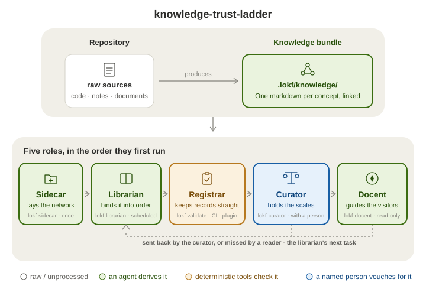

# Knowledge Trust Ladder

This page is for readers aged 13 to 18. It retells [README.md](README.md) in shorter words. The full page has every detail.

<p align="center">
  <picture>
    <source media="(prefers-color-scheme: dark)" srcset=".assets/knowledge-trust-ladder-card-dimmed.svg">
    
  </picture>
</p>

## What does it do?

Knowledge Trust Ladder keeps a repository's knowledge as a **collection**. Each entry shows where it came from and how far it has been checked.

Three things can happen to every entry, and the bundle records which of them happened:

- An agent derives it.
- Deterministic tools check it. A check gives the same answer every time.
- A named person vouches for it.

## Why does a project need it?

The knowledge already exists, in code, documents, diagrams and policies. But every task starts the same way. Someone finds the material, connects it, and judges what is still true. Then the next person or assistant pays for that work again.

A **knowledge bundle** keeps that work instead of throwing it away. It is a plain folder of Markdown concept files, like a library's catalogue. It sits between the sources and whoever reads them, a person or an agent. It lasts from one task to the next.

A catalogue is useful only when a reader can tell which entries are sound. So each entry answers one question: who is responsible for the quality of this context?

## Who does the work?

Knowledge Trust Ladder names its roles after people who work in libraries and museums. Four of the roles are [Agent Skills](https://agentskills.io/home).

- The **sidecar** sets the project up, once. It adds `.lokf/`, a folder beside the code like `.git/`, kept out of the project's build.
- The **librarian** fills the bundle, often and on a schedule. It reads the repository, writes each concept with its sources, and links the concepts together. It records facts about the repository, never verdicts about truth.
- The **curator** is always a person, and the skill only helps. It puts the source next to each claim. The person decides: confirm, correct, retire or send back.
- The **docent** answers questions from the bundle, and says how far each answer has been checked. Docent is a museum's name for a guide. When the bundle has no answer, the docent records the miss for the librarian. It never changes the bundle.

The fifth role, the **registrar**, keeps the records in order, and programs play it. The `lokf` toolkit checks every change. On each pull request that touches the bundle, [`knowledge-registrar.yaml`](.github/workflows/knowledge-registrar.yaml) checks it in continuous integration (CI).

The librarian writes the bundle only through one script, `knowledge-apply.sh`, called **the pen**. The pen stamps where each record came from. It refuses a change that would forge or remove a person's confirmation. Another script, `knowledge-report.sh`, works out each trust label, so no model does that arithmetic.

One more skill has no role of its own. [`ktl-prose`](skills/ktl-prose/SKILL.md) is the librarian's copy editor. It rewords what an agent wrote in plain English, and changes the wording but never a fact.

## How far can you trust an entry?

Each entry carries a label in plain words:

- **Confirmed by a person**: a named person checked it against its source.
- **Checked by automation only**: automation re-checked that the source still matches, and no person has.
- **Nobody has checked this yet**: no check of any kind is recorded.

Other labels say an entry is **still a draft**, **edited since a person last confirmed it**, **past its review date** or **retired**.

The labels are worked out from each entry every time it is read, and never stored. So they cannot drift from what they describe. The number to watch is **confirmed by a person: n of N**. It is meant to rise slowly, a handful of concepts in a sitting.

## How do I try it?

Install the sidecar and the librarian with one command:

```bash
npx skills add noelmcloughlin/knowledge-trust-ladder \
  --skill ktl-sidecar --skill ktl-librarian --yes
```

Add the curator once there is a bundle worth trusting. [docs/install.md](docs/install.md) gives the other ways to install, and what each skill needs on the machine.

You can also just ask questions. Install the docent into an agent you already use:

`npx skills add noelmcloughlin/knowledge-trust-ladder --skill ktl-docent --yes`

The docent answers from this repository's own bundle. See [eight captured answers](docs/examples/docent.md).

## Where can I read more?

- [docs/for-the-curious.md](docs/for-the-curious.md): who writes the bundle and what checks it.
- [The bundle's glossary](.lokf/knowledge/glossary/index.md): what the project's own words mean, such as *sidecar*, *registrar*, *docent*, *desk* and *the pen*.
- [docs/obsidian.md](docs/obsidian.md): the bundle in [Obsidian](https://obsidian.md/), and the two plugins.
- [CONTRIBUTING.md](CONTRIBUTING.md) and [SECURITY.md](SECURITY.md): how to help, and how to report a security issue.

## Who made the parts?

[Nolan Nichols](https://lokf.nolan-nichols.com/) created [LOKF](https://lokf.nolan-nichols.com/specification/), the format the bundle is written in. This is an independent project, not an official distribution of LOKF or of the Open Knowledge Format. It is released under the [Apache License 2.0](LICENSE).
