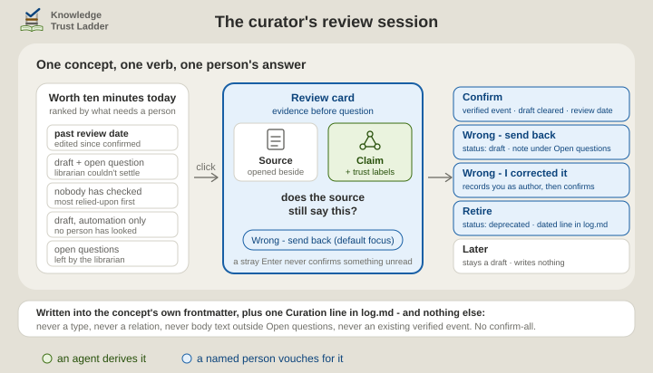

# The curator

This page is for the person who decides what a bundle may claim.

The **curator** *holds the scales*. The curator is always a person: the one who authenticates a claim, weighs where it came from, and decides what the team accepts as true. The skill and the plugin that carry the name are that person's assistants, and reach no verdict of their own.

| | |
| --- | --- |
| **Played by** | a named person, helped by the [`ktl-curator`](../../skills/ktl-curator/SKILL.md) skill |
| **Runs** | a little, regularly |
| **Writes** | a confirmation in that person's name, a status, a review date or an open question, and one line in `log.md` |
| **Never** | derives a concept. The skill never confirms anything itself |
| **Checked by** | the [registrar](registrar.md)'s gate, which asks the forge whether that person approved or signed |
| **In Obsidian** | the [KTL Curator](https://w3id.org/ktl/curator/) plugin, the same review session without an agent ([obsidian.md](../obsidian.md#plugin-for-skill)) |
| **Line of defence** | first, as the checker ([three-lines.md](../three-lines.md)) |

## Ask it

- "How far can I trust this bundle?"
- "What in the bundle needs my confirmation?"
- "Start a review session."

## What a session looks like

The skill prints a one-screen report first: the health line, what is worth ten minutes today, and the questions that wait. A review session follows only when you say yes. It takes one concept at a time, shows the source before the claim, and records one verb. Where the librarian quoted the passage a claim rests on, the session shows that passage where it sits in the file.

| Verb | What it records |
| --- | --- |
| **Confirm** | a confirmation in your name, and a review date you accept |
| **Wrong - send back** | a draft status and your note, for the librarian's next run |
| **Wrong - correct now** | your correction, as your own edit and your confirmation |
| **Retire** | the concept as retired, and what replaced it |
| **Later** | nothing but a draft status or a review date |

  <picture>
    <source media="(prefers-color-scheme: dark)" srcset="../../.assets/ktl-review-session-dark.svg">
    
  </picture>

Your name on a confirmation comes from the forge you are signed in to, never from what you type.

## Where the rest is written

- **What it needs installed**: [install.md](../install.md#what-each-skill-needs).
- **The labels the report uses**: [Trust stays visible](../architecture.md#trust-stays-visible).
- **Signing, which the gate reads**: [signing-commits.md](../signing-commits.md).
- **Who is accountable for what**: [three-lines.md](../three-lines.md).
