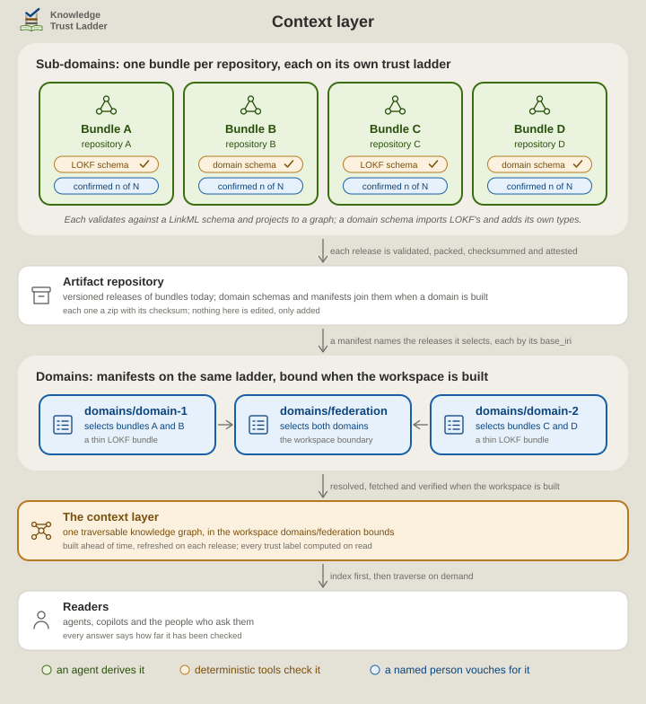
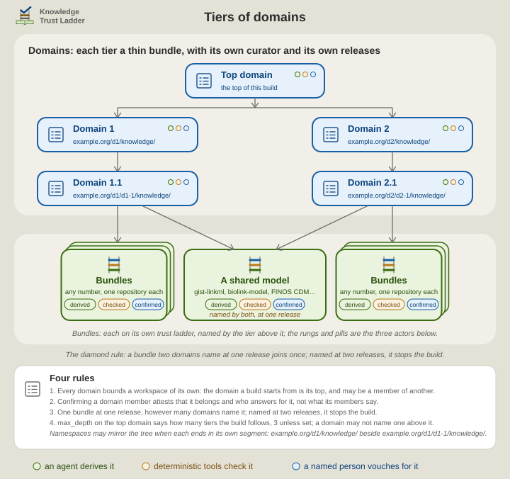
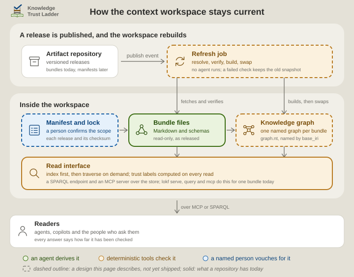

# The curated context layer: one bundle, and a federation of bundles

> [!NOTE]
> This page is for anyone deciding what a context layer is, what one Knowledge Trust Ladder (KTL) bundle already provides, and what it would take to federate many LOKF bundles into one layer. Each quotation is from the source's own text, read on 2026-10-12. The domain tiers and the workspace on this page were released on 2026-10-16 as the sidecar's federation templates, and [ktl-federation](https://w3id.org/ktl/federation/) is the first host. The table under [What exists today](#what-exists-today-and-what-is-design) says what remains a design. [What a KTL context layer integrates with](context-layer-technology.md) surveys the stores, catalogues, agent surfaces and artifact repositories.

Below, a *context layer* is a governed layer between an organisation's sources and whoever consumes them, a person or an agent, that persists from one task to the next. *The bundle* is the corpus KTL keeps in `.lokf/knowledge/`, one Markdown concept per file. A *domain* is a named set of bundles with one accountable owner. A domain may name other domains, and the domain a build starts from is that build's *top domain*; the same domain may be a member of another. *The workspace* is the built graph a reader queries.

## What people mean by a context layer

Unblocked states the minimum: "A real context layer in 2026 has four non-negotiable properties: heterogeneous source ingestion, on-demand surfacing, cross-source conflict resolution, and per-query permission enforcement." Atlan adds what enterprise scale requires: "Multi-domain federation. Each domain owns its definitions but contributes to one graph. Conflicts get arbitrated, not duplicated." That is the shape Zhamak Dehghani named in 2020 for data mesh, "federated computational governance", a model "led by the federation of domain data product owners and data platform product owners" under "a set of global rules".

The ownership point is older than the agents. Efficiently Connected notes that federation technology "cannot make a Head of Retail Banking agree to share definitional ownership with an AML team", and that conversational agents return "whichever definition they encountered most frequently".

Google Cloud took a different approach. The Open Knowledge Format (OKF) "formalizes the LLM-wiki pattern into a portable, interoperable format": "a directory of markdown files with YAML frontmatter". Under the heading "Format, not platform", Google adds: "No complex compression scheme, no new runtime, no required SDK." A format leaves the work open: deciding what counts as trusted knowledge, how updates are reviewed, and what a consumer does with an unknown type or stale context. KTL exists for that work. [Prose, Structure, Meaning, Context](architecture.md#prose-structure-meaning-context) says how it reads OKF's trust goal.

## One bundle is one repository's context layer

The table sets Unblocked's four properties, and the two the others add, against what a bundle does.

| In the discourse | In a KTL bundle | Where it stops |
| --- | --- | --- |
| Heterogeneous source ingestion | The **librarian** derives each concept from a source it names in `resource` and `sources` ([who writes the bundle](for-the-curious.md#who-writes-the-bundle-and-what-checks-it)) | One repository's sources. A second repository is a second bundle |
| On-demand surfacing | A reader opens `index.md` first. The **docent** answers from the bundle and labels each concept it used ([the index as the retrieval interface](wikiskill.md)) | Files, and one in-process graph, until something serves them |
| Cross-source conflict resolution | The **curator**, a named person, records the verdict: confirm, correct, retire or send back. A reader's disagreement goes to `feedback.md` | One bundle. Two bundles that define one term differently have no arbiter yet |
| Per-query permission enforcement | None of its own. The repository's access control is the bundle's | Nothing finer than the repository |
| Provenance and trust | `generated` and `verified` events on every concept, and each label computed on read, never stored ([Trust stays visible](architecture.md#trust-stays-visible), [four levels of checking](for-the-curious.md#four-levels-of-checking)) | Who checked and when, not that the source is right |
| Format, not platform | LOKF, a semantic profile of OKF: Markdown a person reads, a LinkML schema that checks it, a graph any SPARQL store loads | A domain outside LOKF's vocabulary needs a [domain schema](for-the-curious.md#when-the-vocabulary-stops-fitting) |

So one bundle is already one repository's context layer, with the fourth of Unblocked's properties left to whatever hosts it.

## Many bundles federated into one context layer: the design

Domains select released bundles, and a person confirms each domain. A top domain selects domains and bounds the workspace.

  <picture>
    <source media="(prefers-color-scheme: dark)" srcset="../.assets/ktl-federated-context-layer-dark.svg">
    
  </picture>

**What exists.** A repository that installed the sidecar releases its bundle. The template workflow [`knowledge-release.yaml`](../skills/ktl-sidecar/templates/github/knowledge-release.yaml) validates the bundle with the registrar's checks and packs it as a reproducible zip whose root is `knowledge/`. It writes a `.sha256` beside the zip, attaches both to the release, and records a build attestation where the forge offers one. Nothing in that zip is edited afterwards. A domain schema, where the bundle has one, is released beside the bundle as `schema-<tag>-<name>.yaml` with its own checksum, when the justfile's `schema` line names it.

**What OKF leaves open.** OKF calls a bundle "The unit of distribution" and lets it be distributed as a git repository, as a tarball or zip, or as a subdirectory of a larger repository. It says nothing about one bundle naming another, a catalogue of bundles, or what a reader may see of a bundle across a trust boundary. Its trackers ask for all three, in these requests:

- a bundle-local registry for external references ([knowledge-catalog #175](https://github.com/GoogleCloudPlatform/knowledge-catalog/issues/175));
- discovery across a set of bundles ([#302](https://github.com/GoogleCloudPlatform/knowledge-catalog/issues/302));
- collection-scoped metadata ([#214](https://github.com/GoogleCloudPlatform/knowledge-catalog/issues/214));
- an `imported` marker that does not inherit trust ([open-knowledge-format #15](https://github.com/GoogleCloudPlatform/open-knowledge-format/issues/15));
- partial visibility across a trust boundary ([#32](https://github.com/GoogleCloudPlatform/open-knowledge-format/issues/32)).

None had a maintainer's reply when read.

**What LOKF specifies.** Section 11 of the LOKF specification, "Federation: registries of bundles", answers in linked-data terms. A bundle publishes the four files `lokf export` writes, `graph.nt` among them. A registry is a `lokf-registry.yaml`, a DCAT catalogue of VoID datasets, one entry per member bundle keyed by its `base_iri`. Any IRI resolves to its owner by the longest matching `base_iri`, which the specification calls "pure string arithmetic" with "no network, no shared database". An IRI no member owns is "a tolerated dangling link, not an error". Member namespaces may not nest. The toolkit's `lokf registry init`, `add`, `list` and `resolve` implement this offline part today. The federated store that section 11.4 describes is marked informative and is not built.

**What this design adds: domains as manifests.** A domain is itself a thin LOKF bundle, kept in its own repository and released the same way. Its concepts are the member bundles. Each member is a `Dataset` concept whose `distribution` names the release zip by `access_url`, whose `version` is the release tag, and whose `isPartOf` names the domain concept.

Each cross-bundle claim a domain makes is a concept with typed relations, whose targets are full IRIs in the members' namespaces. Such a claim says, for example, that bundle A's term is bundle C's term, or that A depends on C. LOKF has no catalogue class and no checksum slot, so the domain bundle carries a one-file domain schema, written as [the librarian's recipe](../skills/ktl-librarian/references/domain-schema.md) says. It defines `Domain` as a `Dataset` with `class_uri: dcat:Catalog`, and `MemberBundle` as a `Dataset` with `checksum` and `release`. The same validator checks it.

Nothing is copied upward: a domain selects releases, so a new release of a member can never leave a stale copy inside the domain. A top domain selects domains the same way. A domain confirmation therefore attests two things only: that these members belong, and that the cross-bundle claims hold. Each member keeps its own labels. The **curator** confirms a membership concept as any other, and the **registrar**'s gate ties the confirmation to the person.

## Tiers: a domain of domains

A member whose released bundle is itself a domain is followed: its members join the same workspace, and the lock says which domain named each. So a company's legal structure, a legal domain of lines of business, each a domain of business segments, each a domain of business areas, ends at bundles the way a flat domain does, and a competence structure is a second tree over the same bundles. Each tier is a repository of its own, with its own curator and its own releases.

  <picture>
    <source media="(prefers-color-scheme: dark)" srcset="../.assets/ktl-federation-tiers-dark.svg">
    
  </picture>

Four rules keep a tree of domains sound.

- **Every domain bounds a workspace of its own.** The domain a build starts from is that build's top; the same domain may be a member of another, and its own build knows nothing of the one above. A member concept is typed `MemberDomain` when the bundle it names is a domain, so a reader of the manifest sees a delegation without unpacking the zip; a `MemberBundle` whose zip holds a `Domain` concept is followed all the same, and the lock marks it.
- **Confirming a domain confirms the delegation.** The upper curator's confirmation of a domain member attests that the domain belongs and who answers for it, not what its members say. Each tier's owner answers for that tier, as [Lines are roles, not people](three-lines.md#lines-are-roles-not-people) says a role is held.
- **The diamond rule.** A bundle two domains name at one release joins once, named by both in the lock, because the two name the same bytes. Named at two releases, it stops the build, because a named graph holds one release, and the two owners align their pins. An upper ontology such as gist is the ordinary case, not the edge: every sub-domain that links to its terms names it, so it is reached by several paths.
- **The depth is the top domain's to set.** `max_depth` on the top `Domain` concept is how many tiers of members the build follows, 3 unless set; the domain's own members are tier 1, and a domain found at the last tier stops the build rather than being cut without a word. A domain may not name itself or a domain above it.

Namespaces may mirror the tree. The registry refuses one `base_iri` nested inside another, and a path hierarchy satisfies it when each tier's namespace ends in its own segment: `https://corp.example/knowledge/`, `https://corp.example/legal/knowledge/`, `https://corp.example/legal/lob-a/knowledge/` and `https://corp.example/legal/lob-a/segment-1/knowledge/` are accepted together, and `https://corp.example/legal/` alone is refused. The gate is the top domain's: one workspace has one `unowned_targets`, and a sub-domain's applies to its own build.

## How the workspace stays current

The workspace is a materialised view of the top domain, built ahead of time and rebuilt on publish, by a job that runs no agent.

  <picture>
    <source media="(prefers-color-scheme: dark)" srcset="../.assets/ktl-context-workspace-dark.svg">
    
  </picture>

1. **A publish event starts it.** Artifactory sends a webhook when an artifact is "deployed to a repository". Its documentation shows that webhook starting a GitHub Actions workflow through `workflow_dispatch`, with the artifact path as an input. A forge's own release event does the same for GitHub Releases.
2. **Resolve.** The job reads the top domain's manifest, follows each domain to its members, and writes a lock: one line per release with its URL and checksum.
3. **Verify.** Each zip is checked against its `.sha256`, and on GitHub against its attestation with `gh attestation verify`. A failure stops the job, and the old snapshot stays.
4. **Register and export.** Each release is unpacked, registered with `lokf registry add` and exported with `lokf export`. Registering it counts its triples and checks that its concepts sit under its declared `base_iri`.
5. **Load.** Each `graph.nt` goes into a named graph whose IRI is the bundle's `base_iri`, as section 11.4 intends. In SPARQL, `GRAPH ?g` then says which bundle asserted a triple.
6. **Gate.** `lokf validate --check-refs` resolves only targets inside a bundle's own namespace, so a link from A to C is first checkable here. The job lists every out-of-namespace target by SPARQL and resolves each against the registry. An unowned IRI fails the build, or is reported, as the domain's policy says.
7. **Swap.** The new graphs replace the old under one snapshot version, in one atomic step. A reader never sees half a federation.

**Pre-built is not pre-loaded.** Anthropic's guidance is that agents "maintain lightweight identifiers (file paths, stored queries, web links, etc.) and use these references to dynamically load data into context at runtime", which "enables progressive disclosure". OKF gives `index.md` the same job, "to support progressive disclosure". So the workspace serves the index first and lets a reader traverse on demand, over a SPARQL endpoint and a Model Context Protocol (MCP) server. The toolkit's `lokf serve`, `lokf query` and `lokf mcp` do this for one bundle today.

**Trust at read time.** No trust label is stored in the snapshot. A snapshot that stores labels drifts from what it describes within a day. In the workspace, SPARQL over `generated` and `verified` gives the same labels the report script computes from frontmatter ([the same labels as SPARQL](../skills/ktl-curator/references/queries.md)), against the clock at the moment of the query. A concept reads as past its review date the day after that date, with no rebuild. A release is the only event that changes a graph, and the publish hook catches every release.

## What exists today, and what is design

| Part | Status | Where |
| --- | --- | --- |
| A bundle validated, packed, checksummed, attested and attached to a release | exists | `knowledge-release.yaml` in the sidecar template |
| The registrar's gate and the report script | exist | [the fifth role](architecture.md#the-fifth-role-which-is-not-a-skill) |
| `lokf export`: `graph.nt`, `concepts.jsonld`, `graph.json`, `datasets.jsonld` | exists | lokf 0.8.0 |
| `lokf registry init`, `add`, `list` and `resolve`: the routing table, offline | exists | lokf 0.8.0, specification sections 11.1 to 11.3 |
| `lokf serve`, `query` and `mcp` over one bundle | exist | lokf 0.8.0 |
| `lokf tables` to Parquet, with BigQuery or Athena table definitions | exists | lokf 0.8.0 |
| Domains as thin bundles, their domain schema, a person's confirmation of membership | exists | `domain.yaml` in the sidecar's templates, and the first domain host, [ktl-federation](https://w3id.org/ktl/federation/), whose members are this bundle, ai-linkmo's and lmodel/gist's; the curator's [domain-bundle.md](../skills/ktl-curator/references/domain-bundle.md) |
| The lock, the refresh job and the atomic swap | exists | `knowledge-federate.py` and `knowledge-federation.yaml` in the sidecar's templates ([automation.md](../skills/ktl-sidecar/references/automation.md#knowledge-federationyaml-the-workspace-of-a-domain-host)) |
| One named graph per bundle | exists | `knowledge-federate.py build` in the sidecar's federation templates |
| A domain of domains: tiers followed to the depth the top domain sets, the diamond rule, a `MemberDomain` type | exists | `knowledge-federate.py build` and `domain.yaml` in the sidecar's federation templates ([Tiers](#tiers-a-domain-of-domains)) |
| A `lokf-registry` MCP server: `resolve_iri`, `neighbors`, `subgraph`, `federated_sparql`, `read_document` | exists | `knowledge-federate.py mcp` in the sidecar's federation templates, over the workspace, the index as its instructions; specification section 11.4 |
| A read-only SPARQL endpoint over the workspace | exists | `knowledge-federate.py serve`, or the Oxigraph server image loading `graph.nq` ([domain-bundle.md](../skills/ktl-curator/references/domain-bundle.md#reading-the-workspace)) |
| A domain schema released beside its bundle | exists | `knowledge-release.yaml` attaches `schema-<tag>-<name>.yaml` when the justfile names one; the build validates the member against it |
| Lazy loading of a member's graph on first use | design | specification section 11.4, marked informative; the workspace loads every member at build |
| Harvesting remote artifacts, and the `sensitivity` gate | design | specification section 11.5; the field exists, and nothing reads it |
| Per-query permissions | design | the store's and the artifact repository's access control, not the bundle's |

## Decisions an adopter must make

- **Pin or float.** This design pins: each member concept names one release, and a person's confirmation of the domain covers those releases. A member's new release then changes nothing until a person confirms a domain release that names it. So a pinned domain needs a release of its own for every member release. A manifest that floats on a range is fresher, but its curator has not seen each release it picks up. The workspace's lock then holds the exact releases, as package managers keep broad requirements in a project file and exact versions in a lockfile. Either way, the report must say, at each tier, which members have moved since the domain was last confirmed. Across tiers, pinning compounds: a leaf's release reaches the top workspace only after a confirmation and a release at every tier between, five of each in the company above. The templates pin at every tier today. Whether a domain member may float on its sub-domain's newest release, so that an upper tier's confirmation attests membership and ownership rather than one release, while leaf members stay pinned where the content is, is the decision left open.
- **Cross-bundle links.** Make the resolution step a build gate from the start. A dangling link that a bundle must tolerate, as OKF requires, is a defect in a domain, because a person confirmed the claim it belongs to.
- **Stable IRIs.** Keep each bundle's `base_iri` constant across releases and record the version on the graph's metadata, or every cross-bundle edge breaks at each release. Give a domain a namespace beside its members', never above them: the registry refuses a `base_iri` that nests inside another, and a path that mirrors the tree satisfies it when each tier's namespace ends in its own segment ([Tiers](#tiers-a-domain-of-domains)).
- **Who arbitrates.** When A and C define one term differently, the domain's owner decides, and the decision is a confirmed concept in the domain bundle, not a rewrite of either member. Atlan's "Conflicts get arbitrated, not duplicated" names the duty, and [Lines are roles, not people](three-lines.md#lines-are-roles-not-people) says who may hold it.
- **Vocabulary fit.** A concept whose type is outside the schema is tolerated as a generic concept and carries no agreed meaning. Admit a bundle to a domain on vocabulary fit, and publish each domain schema as an artifact so the workspace can load it ([when the vocabulary stops fitting](for-the-curious.md#when-the-vocabulary-stops-fitting)).
- **What a member adds.** A domain admits a bundle on its admission rule: released with the sidecar's workflow, validating against a published schema, a stable namespace under an authority its publisher controls, one accountable owner. Whether a member adds value is another test, and the strict one is whether readers query across it or other members link into it. A federation whose members never link to one another has proved its mechanism, not yet its worth. A public bundle cannot decline to be catalogued, as with any public dataset; the domain's owner answers for the admission.
- **Permissions.** OKF is explicit: "Trust tiers are advisory signals, not access control." Section 11.5 of the LOKF specification keeps credentials out of the registry and admits public artifacts or local checkouts only. Per-query permission lives in the artifact repository and in the store the workspace runs on. A bundle that must not be seen whole does not join a domain.

## Sources

- Alexander, K., Cyganiak, R., Hausenblas, M. and Zhao, J. (2011). Describing Linked Datasets with the VoID Vocabulary. W3C Interest Group Note. <https://www.w3.org/TR/void/>
- Anthropic (2025). Effective context engineering for AI agents. <https://www.anthropic.com/engineering/effective-context-engineering-for-ai-agents>
- Atlan (2026). Context layer. Atlan Documentation. <https://docs.atlan.com/agents/concepts/context-layer>
- Dehghani, Z. (2020). Data Mesh Principles and Logical Architecture. <https://martinfowler.com/articles/data-mesh-principles.html>
- GitHub. Artifact attestations. GitHub Docs. <https://docs.github.com/en/actions/concepts/security/artifact-attestations>
- Google Cloud (2026). Open Knowledge Format, specification version 0.2. <https://github.com/GoogleCloudPlatform/open-knowledge-format/blob/main/SPEC.md>
- Harris, S. and Seaborne, A. (2013). SPARQL 1.1 Query Language, section 13. W3C Recommendation. <https://www.w3.org/TR/sparql11-query/>
- JFrog. Webhook Event Types, and Trigger a GitHub Action using a Custom Webhook. <https://docs.jfrog.com/integrations/docs/webhook-event-types>, <https://docs.jfrog.com/integrations/docs/trigger-a-github-action-using-a-custom-webhook>
- McVeety, S. and Hormati, A. (2026). Introducing the Open Knowledge Format. Google Cloud. <https://cloud.google.com/blog/products/data-analytics/how-the-open-knowledge-format-can-improve-data-sharing>
- Nashawaty, P. and Weston, S. (2026). Enterprise AI Governance: The Operating Model AI Agents Need. Efficiently Connected. <https://www.efficientlyconnected.com/enterprise-ai-governance-operating-model/>
- Nichols, N. (2026). LOKF specification, version 0.2, section 11: Federation, registries of bundles. <https://lokf.nolan-nichols.com/specification/#11-federation-registries-of-bundles>. The toolkit as released at 0.8.0: <https://github.com/nicholsn/lokf/blob/v0.8.0/SPEC.md>
- Pilarinos, D. (2026). The Context Layer: What It Is and Why Every AI Agent Needs One. Unblocked. <https://getunblocked.com/blog/context-layer-ai-agents>
