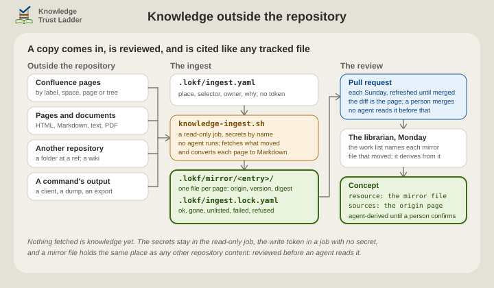

# How to mirror knowledge from outside the repository

This page is for a team that keeps much of its knowledge outside the repository.

The librarian reads the repository, and a bundle cites what the librarian can read. The ingest copies that knowledge into the repository. A manifest names each source, a script writes it as Markdown under `.lokf/mirror/`, and a pull request shows what changed. The librarian then derives concepts from the copy as from any tracked file, citing both the copy and its origin.

Nothing in the trust ladder changes. A concept derived from a wiki page is agent-derived until a person confirms it, as one derived from a README is. Knowledge Trust Ladder (KTL) keeps the same work list, gate and review.

<p align="center">
  <picture>
    <source media="(prefers-color-scheme: dark)" srcset="../.assets/ktl-ingest-dark.svg">
    
  </picture>
</p>

***As a flow diagram, drawn with Archify: [light](../.assets/companions/ktl-ingest.svg), [dark](../.assets/companions/ktl-ingest-dark.svg).***

[The ingest reference](ingest-reference.md) lists what can be mirrored, every key of the manifest, and what the mirror and the lock record.

## Turn it on

1. Install the ingest files with ktl-sidecar's Step 5, or its repair: the script and its shell half under `.lokf/scripts/`, the workflow and the pull request template.
2. Copy `.lokf/ingest.yaml.sample` to `.lokf/ingest.yaml` and replace its examples. A sidecar installed before the sample existed gets it from the same repair.
3. Store each credential as a secret in the `knowledge-ingest` Environment, limited to the default branch, under the name the manifest gives ([how](../skills/ktl-sidecar/references/automation.md#keep-each-secret-in-its-environment)). Every name starts `KNOWLEDGE_INGEST_`, and the workflow hands over those secrets only. For Confluence Cloud, use an API token with read scopes and an expiry, with the account's email as the user.
4. Set the repository variable `KNOWLEDGE_INGEST_ENABLED` to `true`, and turn on *Allow GitHub Actions to create and approve pull requests* under Settings, Actions, General.
5. Start one run from the Actions tab and read its summary.

The pull request is opened on the branch `knowledge-ingest`. The sidecar's [automation page](../skills/ktl-sidecar/references/automation.md#knowledge-ingestyaml-knowledge-outside-the-repository) has the workflow's jobs and switches.

A workflow runs the script on Sundays and keeps one pull request open with the changes, refreshed until a person merges it. The librarian's Monday run then finds each concept whose mirror file moved in its work list.

## Run it by hand

```sh
bash .lokf/scripts/knowledge-ingest.sh --dry-run                 # list and compare, write nothing
bash .lokf/scripts/knowledge-ingest.sh --visibility private      # every entry
bash .lokf/scripts/knowledge-ingest.sh --only platform-runbooks  # one entry
bash .lokf/scripts/knowledge-ingest.sh --prune                   # remove gone and unlisted files no concept cites, recorded so by an earlier run
bash .lokf/scripts/knowledge-ingest.sh --patch                   # Reference concepts for the entries that ask
```

Set the same variable names in the environment. The librarian runs the first command itself at the start of a live session. Commit the mirror and the lock with the bundle change. A host with no git runs the script the same way, and the lock is its record.

The preflight's `ingest` line counts files the lock names that are missing, files the lock does not name, and files waiting for a prune. The confidential cache under `.lokf/.cache/` may be deleted at any time, and the next run fetches it again.

A run starts no more work after 25 minutes, so it ends inside the workflow's 30, and the next run takes up what it did not reach. `--time-limit 0` lifts the limit for a long first run by hand.

## Review the pull request

The body is the run's summary, then the checklist. Read the diff as you would read the page: is this text something the repository should hold? Remove a page that should not be in the repository from the manifest, not from the diff. A file marked `gone` or `unlisted` stays while a concept cites it, until the librarian has handled that concept. Once none does, the next scheduled run removes it, and the diff shows the removal. The lock's `since` date says how long it has been away. A line marked `failed` with a credential's name is a secret not yet set, or expired, and the run shows it as a warning too. So is a line about the time limit.

A pull request closed without merging is a no: a scheduled run proposes the mirror again only once the manifest has changed, and a run started by hand proposes it now. No checks run on this pull request, and that is expected: GitHub starts none for a pull request a workflow opens, and the mirror holds no bundle file to check. Merge it, and the librarian's next run reads what changed.

## Where the rest is written

- **What the librarian does with a mirrored page**: [the ingest reference](ingest-reference.md#what-the-librarian-does-with-a-mirror).
- **What guards the ingest**: [the ingest reference](ingest-reference.md#security) and the [threat model](threat-model.md#the-ingest-workflow).
