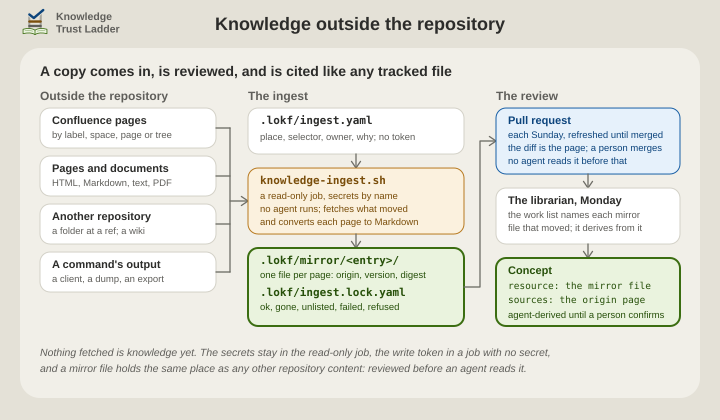

# Knowledge outside the repository

This page is for a team that keeps much of its knowledge outside the repository.

The librarian reads the repository, and a bundle cites what the librarian can read. The ingest copies that knowledge into the repository. A manifest names each source, a script writes it as Markdown under `.lokf/mirror/`, and a pull request shows what changed. The librarian then derives concepts from the copy as from any tracked file, citing both the copy and its origin.

Nothing in the trust ladder changes. A concept derived from a wiki page is agent-derived until a person confirms it, as one derived from a README is. Knowledge Trust Ladder (KTL) keeps the same work list, gate and review.

<p align="center">
  <picture>
    <source media="(prefers-color-scheme: dark)" srcset="../.assets/ktl-ingest-dark.svg">
    
  </picture>
</p>

***As a flow diagram, drawn with Archify: [light](../.assets/companions/ktl-ingest.svg), [dark](../.assets/companions/ktl-ingest-dark.svg).***

## What can be mirrored

- **Confluence pages**, chosen by label, space, page, page tree or CQL query, on Cloud or Data Center.
- **Pages and documents at an address**: HTML, Markdown, plain text and PDF. Most PDFs work, meaning any whose text can be selected and copied in a viewer. A scan of paper holds pictures of pages and no text, and is refused.
- **Files in another git repository**, a folder at a branch, tag or commit. A GitHub or GitLab wiki is such a repository. A run downloads the file list, then only the files that changed. Every such entry needs git 2.31 or later. Git follows no redirect with a credential, or where the manifest refuses private addresses. There an entry that names a host, not an IP address, needs git 2.37 or later, unless a proxy resolves its name. So name a moved repository by its new address, and a host outside ASCII by its `xn--` form. Name the address git fetches, too: one that git's own configuration rewrites, by `url.<base>.insteadOf`, is refused.
- **The output of a command** this repository holds: a client for a service the ingest has no fetcher for, a schema dump, an export.

There is no fetcher for Jira, since issues are unsuitable as knowledge sources. Attachments and images are not fetched, and a link to one keeps its origin address. A source that is not text, such as a database, is mirrored only through a command that prints it.

## How it works

**The manifest**, `.lokf/ingest.yaml`, lists what to mirror: for each entry a place, a selector, who answers for the source and why this repository mirrors it. It holds no token. An `auth` block names environment variables.

**The mirror**, `.lokf/mirror/<entry id>/`, holds one Markdown file per page or document. Each opens with a header: origin, title, version, digest of the bytes fetched, retrieval time and converter. A file is named by the item's stable identity, a page id or a path, never its title, so a retitled page is the same file. The workflow publishes a name of letters, digits and `._/@+-` only, so a file named otherwise is spelled with those characters, with a digest of its name added: `Release Notes.md` becomes `Release-Notes-2040e8c7.md`, and its header keeps the name. Links are made absolute, and a PDF carries a comment before each page so a concept can cite the page.

**The lock**, `.lokf/ingest.lock.yaml`, records the same per item, with one of these statuses:

- `ok` for a current copy;
- `gone` after a 404 or 410;
- `unlisted` when the selector no longer returns it, or returns a file that is binary now;
- `failed` when a request did not complete;
- `refused`, with the reason;
- `skipped` for a binary file that a `git` entry's include matches.

The mirror and the lock change only when content changes.

The mirror is tracked, and stays so: the work list, the gate and coverage all read it as repository content, and the scheduled librarian holds no secret with which to fetch. Never clear it before a run. Refresh it instead, since a run fetches only what moved and restores any file missing from the disk. `git checkout -- .lokf/mirror` brings back committed files without a fetch.

A workflow runs the script on Sundays and keeps one pull request open with the changes, refreshed until a person merges it. The librarian's Monday run then finds each concept whose mirror file moved in its work list.

## The manifest

```yaml
ingest_version: "1"
max_total_bytes: 50000000        # the whole mirror; an item that would pass it is refused
allow_private_addresses: false   # true permits intranet addresses, http:// sites and local git paths

services:                        # a site and its credential, written once
  confluence:
    kind: confluence
    site: https://acme.atlassian.net   # as a person knows it; api: datacenter for Data Center
    auth:
      scheme: basic                    # basic, bearer or header; values come from the environment
      user_env: KNOWLEDGE_INGEST_ATLASSIAN_USER
      env: KNOWLEDGE_INGEST_ATLASSIAN_TOKEN
  github:
    kind: git
    auth:
      scheme: basic                    # a fine-grained token with Contents read
      env: KNOWLEDGE_INGEST_GITHUB_TOKEN

defaults:                        # what an entry inherits
  sensitivity: internal          # public, internal or confidential; see below
  lock_details: false            # true records a confidential entry's items in the committed lock
  max_items: 200                 # a selector over this is refused whole, never mirrored in part
  max_item_bytes: 1000000        # each body fetched, and the Markdown written from it
  authors: true                  # false leaves account ids out of the headers

entries:
  - id: platform-runbooks        # lowercase letters, digits and hyphens: it names the folder
    service: confluence
    select:                      # one of: label with an optional space, space, page, tree, cql
      label: ktl
      space: PLAT
    owner: team:platform         # the author the concept's source names
    why: the runbooks the on-call rota follows   # the entry's row in the source map

  - id: ops-wiki                 # a GitHub or GitLab wiki is a git repository
    service: github
    url: https://github.com/acme/platform.wiki.git   # https; http and local paths need allow_private_addresses
    ref: master                  # a branch, a tag or a commit; the commit is the version
    path: runbooks
    include: ["*.md"]            # the default; a binary file that matches is skipped and named
    exclude: ["draft-*"]
    owner: team:ops
    why: the on-call wiki, which lives beside the repository

  - id: vendor-protocol
    kind: http                   # HTML, Markdown, text or PDF; ETag and Last-Modified when given
    urls:
      - https://vendor.example/spec/v3.pdf
    convert: pdf-text            # html-markdown, pdf-text or text, when the content type does not say
    sensitivity: public
    license: https://vendor.example/terms
    owner: vendor-example/v3
    reference: true              # --patch drafts a Reference concept per mirrored file
    why: the wire protocol the gateway implements

  - id: schema-dump
    kind: command                # a tracked command's output is the text; its own digest is recorded too
    command: .lokf/ingest/schema-dump.sh
    args: ["--format", "markdown"]
    timeout: 120
    owner: team:data
    disabled: true               # pauses the entry and keeps its mirror
    why: the live database schema
```

A command is code the repository runs in a job that holds secrets, so commit one a person has read. It receives the variables its own `auth` block names, and its last error line is written to the lock. An entry taken out of the manifest loses its folder on the next run, and the summary names each file a concept still cites.

## Sensitivity

A committed mirror is published as far as the repository is, so the script refuses what the repository's visibility does not allow. `public` may be committed anywhere. `internal`, the default, may be committed to a private repository only. `confidential` is never committed: the copy goes to the ignored `.lokf/.cache/mirror/`, a concept names the origin as its `resource`, the work list cannot compare it, and a scheduled librarian reads text no person reviewed.

A confidential entry's records go to `.lokf/.cache/ingest.lock.yaml`, beside its copies. The committed lock says only how the entry's last run went, so no page's title, address or author is committed. The summary counts the entry's items and names none. With `lock_details: true`, the committed lock records the entry's items, as it does for any other entry. The script refuses a `confidential` entry when git does not ignore the cache or tracks a file in it. When an entry's sensitivity or `lock_details` changes, its next run moves its records and removes its files from the old folder, then fetches them into the new one.

The workflow passes the repository's visibility from the forge. By hand, the script asks `gh` when it is signed in, and otherwise counts the repository as public until `--visibility private` says otherwise.

## Turn it on

1. Install the ingest files with ktl-sidecar's Step 5, or its repair: the script and its shell half under `.lokf/scripts/`, the workflow and the pull request template.
2. Copy `.lokf/ingest.yaml.sample` to `.lokf/ingest.yaml` and replace its examples.
3. Store each credential as a secret in the `knowledge-ingest` Environment, limited to the default branch, under the name the manifest gives ([how](../skills/ktl-sidecar/references/automation.md#keep-each-secret-in-its-environment)). Every name starts `KNOWLEDGE_INGEST_`, and the workflow hands over those secrets only. For Confluence Cloud, use an API token with read scopes and an expiry, with the account's email as the user.
4. Set the repository variable `KNOWLEDGE_INGEST_ENABLED` to `true`, and turn on *Allow GitHub Actions to create and approve pull requests* under Settings, Actions, General.
5. Start one run from the Actions tab and read its summary.

The pull request is opened on the branch `knowledge-ingest`. The sidecar's [automation page](../skills/ktl-sidecar/references/automation.md#knowledge-ingestyaml-knowledge-outside-the-repository) has the workflow's jobs and switches.

## By hand

```sh
bash .lokf/scripts/knowledge-ingest.sh --dry-run                 # list and compare, write nothing
bash .lokf/scripts/knowledge-ingest.sh --visibility private      # every entry
bash .lokf/scripts/knowledge-ingest.sh --only platform-runbooks  # one entry
bash .lokf/scripts/knowledge-ingest.sh --prune                   # remove gone and unlisted files no concept cites, recorded so by an earlier run
bash .lokf/scripts/knowledge-ingest.sh --patch                   # Reference concepts for the entries that ask
```

Set the same variable names in the environment. The librarian runs the first command itself at the start of a live session. Commit the mirror and the lock with the bundle change. A host with no git runs the script the same way, and the lock is its record. The preflight's `ingest` line counts files the lock names that are missing, files the lock does not name, and files waiting for a prune. The confidential cache under `.lokf/.cache/` may be deleted at any time, and the next run fetches it again. A run starts no more work after 25 minutes, so it ends inside the workflow's 30, and the next run takes up what it did not reach. `--time-limit 0` lifts the limit for a long first run by hand.

## The pull request

The body is the run's summary, then the checklist. Read the diff as you would read the page: is this text something the repository should hold? Remove a page that should not be in the repository from the manifest, not from the diff. A file marked `gone` or `unlisted` stays while a concept cites it, until the librarian has handled that concept. Once none does, the next scheduled run removes it, and the diff shows the removal. The lock's `since` date says how long it has been away. A line marked `failed` with a credential's name is a secret not yet set, or expired, and the run shows it as a warning too. So is a line about the time limit.

A pull request closed without merging is a no: a scheduled run proposes the mirror again only once the manifest has changed, and a run started by hand proposes it now. No checks run on this pull request, and that is expected: GitHub starts none for a pull request a workflow opens, and the mirror holds no bundle file to check. Merge it, and the librarian's next run reads what changed.

## What the librarian does next

The work list names each concept whose mirror file moved, by git history, as it names any moved source. A concept derived from a mirrored page names the mirror file as its `resource` and the origin as a `sources` entry, with the entry's `owner` as `author` and the page's `last_modified`. A `Reference` concept is the other way round: the origin as `resource` and the mirror under `sources`. The source map gains one row per entry, naming the entry's folder, so `knowledge-report.sh coverage` counts the mirror as mapped. The librarian's [ingest reference](../skills/ktl-librarian/references/ingest.md) has the rules.

The curator and the docent need nothing new. A mirror file is a tracked path: the curator quotes it under evidence first, and the docent opens it to check a value and names the origin, version and retrieval date in its footer.

## Security

The ingest keeps its secrets and its write token in separate jobs, and fetches only the addresses the manifest names, within size caps. The [threat model](threat-model.md#the-ingest-workflow) says what else guards it.

Behind a proxy, the proxy resolves each name. The script still refuses a name that resolves locally to a private address. It cannot check a name that resolves only at the proxy, so the proxy must refuse private addresses itself. Where the manifest refuses private addresses, git uses the proxy that `https_proxy` or `all_proxy` names for a `git` entry, and ignores any proxy in git's own configuration.
