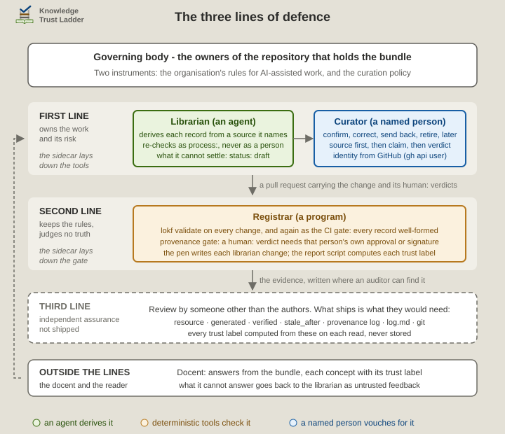

# Three lines of defence

This page is for a governance reader who asks three things of Knowledge Trust Ladder (KTL): who is accountable for a claim, what a machine checks, and what can be examined afterwards.

Regulated industries use the **three lines of defence** to say who owns a risk, who keeps the rules, and who checks independently. The reference version is the Three Lines Model of The Institute of Internal Auditors (IIA), [updated in 2020](https://www.theiia.org/en/content/position-papers/2020/the-iias-three-lines-model-an-update-of-the-three-lines-of-defense/) and reissued as a [Statement of Position](https://www.theiia.org/globalassets/site/resources/statements-of-position/tlm_assurance_advice_support_effective_gov_en.pdf) in 2026.

KTL was not built to it, but each of its roles fits. Every control named on this page already exists in KTL.

| Line | In the model | In KTL |
| --- | --- | --- |
| **First**: owns the work and its risk | operational management | The **librarian** derives every record from a source it names, records its own re-checks as `process:` and never as a person, and marks what it cannot settle `status: draft` with an open question. The **curator**, a named person, decides what the team accepts as true: confirm, correct, send back, retire, or leave for later. Maker and checker: the agent cannot vouch, and the person does not derive. |
| **Second**: ensures compliance, without owning the content | risk and compliance functions | The **registrar** keeps every record well-formed: `lokf validate` on every change, `knowledge-apply.sh`, the pen, as the only way the librarian writes the bundle, `knowledge-report.sh` computing every trust label, and the KTL Registrar plugin in Obsidian. `lokf validate` runs again as the continuous integration (CI) gate. The gate's `provenance` job ties each `human:` verdict that is added or removed to that person's approval of the pull request or their signature on the commit, and the pen refuses to write any `human:` actor. The registrar never judges truth: a verdict is only ever what that person said. |
| **Third**: independent assurance | internal audit | The **bundle** holds the evidence an independent reviewer needs, listed below, and not the review, because assurance is independent only when it comes from someone other than the authors. |

  <picture>
    <source media="(prefers-color-scheme: dark)" srcset="../.assets/ktl-three-lines-dark.svg">
    
  </picture>

The **docent** sits outside the lines, where the reader does, and reports what it could not answer to the librarian, as untrusted input. The **sidecar** installs the tools and the gate. `ktl-prose`, an optional helper, sits on the maker's side of the first line: it rewords what the librarian wrote before a person confirms it. A copy editor is not the author, so it writes no `generated` record, and `log.md` and git record the pass.

Above the lines sits a governing body: for a bundle, the owners of the repository that holds it. Their two instruments are the organisation's rules for AI-assisted work (this project's are its [AI covenant](../AI_COVENANT.md)) and the curation policy. The policy is a concept in the bundle that says who curates and how often each kind of concept is re-confirmed, and it is reviewed like any other concept. The [four levels of checking](for-the-curious.md#four-levels-of-checking) are these same checks ordered by when they happen.

## Lines are roles, not people

The IIA's own text says the lines "are not intended to denote structural elements but a useful differentiation in roles", and that roles "may overlap in practice" given "clear accountability, transparency, and safeguards to preserve objectivity and avoid self-review risks". KTL does not decide who plays each line. The organisation that adopts it does, with one person or a department per line.

The tooling keeps the lines apart whether one person or a department holds each. The **curator**'s identity comes from the forge, never from the person. It is the login this machine is signed in as, or the login under which the forge lists the key the person signs with. It is never git config, which anyone can edit, and never what the person types into the agent's chat. Where an organisation lets one person both author and confirm, the gate takes their signature on the commit, since GitHub will not let them approve their own pull request. A repository that cannot sign, and has nobody else to approve, has one logged exception: an approval from a required reviewer of an Environment.

## What an auditor can check

Every trust label is computed from the frontmatter on each read and never stored, so a label cannot be asserted, only derived from the events behind it. `knowledge-report.sh` does the computing, so the answer does not vary with the reader. Each question an auditor asks has a place where the answer is written:

| Question | Where the answer is |
| --- | --- |
| Where did this come from? | `resource`, `sources[].resource`, `derivedFrom` |
| Who produced the current text, and when? | `generated.by`, `generated.at` |
| Who confirmed it, and when? | `verified[].by`, `verified[].at` |
| Which state of the source was the check made against? | `verified[].revision` and `generated.revision`, from lokf 0.9.0: the commit hash of a file, which the gate resolves against the tree, or an ETag or digest for a URL, which nothing checks. Absent means unrecorded, never unchanged. With or without it, `knowledge-report.sh` lists each confirmed concept whose source has a commit after the one that recorded the confirmation |
| Is the confirmed text the text they saw? | the `validate` job's log: conventions rule 13 fails a change to a confirmed concept's content that leaves `generated` older than the confirmation, so an edited concept reads *edited since* and never as confirmed |
| Was that really them? | the `provenance` job's log on the pull request: the forge's verdict on the approval or the signature, not the runner's. Locally, the curator skill's *Not tied to a signed commit* count |
| When must it be looked at again, and by what rule? | `stale_after`, proposed from `policies/knowledge-curation.md` |
| Has a person's record been removed? | the `provenance` job's log: a confirmation struck out, or gone with its concept, needs that person's approval or signature as an added one does. On the scheduled librarian's pull request, `knowledge-provenance.sh --unattended` in the job that holds the write token |
| What changed, and why? | `log.md`, and git |
| Is the checker independent of the checked? | the JSON Schema is generated from the upstream `lokf.yaml`, not written by the bundle's authors; the toolkit also generates SHACL shapes, which no KTL check runs yet; the bundle projects to RDF and answers [SPARQL](../skills/ktl-curator/references/queries.md) |

Four limits on what that evidence shows:

- A confirmation records who and when. It records which state of the source only when the event carries `revision`, and even then the state the skill fetched, not what the person read.
- The gate checks identity, not entitlement: that `human:ada` is ada, not that ada was the right person. A repository carrying `.lokf/curators/` settles who may confirm. Which kinds of concept each may confirm is still the curation policy's prose.
- An Environment attestation records only that a listed reviewer clicked Approve, not that they opened the source.
- The `provenance` job runs on GitHub. Elsewhere `knowledge-provenance.sh` checks signatures against the keys on file and nothing checks approvals. A host without git has only its platform's version history.

## What the critics say

The model's critics are the UK Parliamentary Commission on Banking Standards (the Commission, below), academics, and the people applying the model to banks and to AI. Two bodies of research also question the kind of tool KTL is: a machine's output checked by a person. Each criticism below is quoted from its source, with what KTL does about it and one of three verdicts:

- **Met by construction.** KTL's design removes the ground for the point.
- **Answered in part.** KTL does something about it, and the section says what is left open.
- **Not KTL's role.** The point stands, and answering it is the job of the organisation that adopts KTL.

| The criticism | Raised by | KTL's answer | Verdict |
| --- | --- | --- | --- |
| [Accountability is diluted across the lines](#accountability-is-diluted-across-the-lines) | the Commission; Davies and Zhivitskaya | one named person per confirmation | Met by construction |
| [The second line cannot challenge the first](#the-second-line-cannot-challenge-the-first) | the Commission; Arndorfer and Minto | the second line is a program | Met by construction |
| [The second line sees only what it is shown](#the-second-line-sees-only-what-it-is-shown) | Zhivitskaya, as Schuett repeats it | the gate reads the whole change and asks the forge | Met by construction, one limit |
| [Process is followed, judgement is absent](#process-is-followed-judgement-is-absent) | the Commission; research on human oversight | source before claim; only a person's verdict is recorded | Answered in part |
| [The machine invents](#the-machine-invents) | Ji et al. | a named source on every record | Answered in part |
| [The lines do not coordinate in practice](#the-lines-do-not-coordinate-in-practice) | Bantleon et al.; Valkenburg and Bongiovanni | every hand-off is written down | Answered in part |
| [Incentives are misaligned, skill is lacking](#incentives-are-misaligned-skill-is-lacking) | Arndorfer and Minto | nothing; the curation policy names curators | Not KTL's role |
| [Internal audit is weak, so add a fourth line](#internal-audit-is-weak-so-add-a-fourth-line) | Arndorfer and Minto | evidence for a third line, not the review | Not KTL's role |
| [The model's effectiveness is untested](#the-models-effectiveness-is-untested) | Davies and Zhivitskaya; Schuett | no claim about itself; a sample for whoever tests it | Not KTL's role |

### Accountability is diluted across the lines

**The criticism.** The Commission found that the three lines "promoted a wholly misplaced sense of security": responsibilities blurred and accountability diluted ([Changing banking for good](https://www.parliament.uk/documents/banking-commission/Banking-final-report-volume-i.pdf), Volume I, conclusions 20 and 134). Davies and Zhivitskaya note that some argue spreading responsibility across lines reduces accountability ([Global Policy, 2018](https://doi.org/10.1111/1758-5899.12568)).

**What KTL does.** Every confirmation names one person in `verified[].by`, and the librarian's re-checks are `process:`, never a person, so accountability is per claim, not per department.

**Verdict: met by construction.**

### The second line cannot challenge the first

**The criticism.** The Commission found that the second line "lacked the status to challenge front-line staff effectively", and its remedy was for "these lines to be separate, with distinct authority given to internal control". Arndorfer and Minto count a second line without organisational independence among four weaknesses seen in bank failures ([Financial Stability Institute Occasional Paper 11, 2015](https://www.bis.org/fsi/fsipapers11.pdf)).

**What KTL does.** The second line is a program. `lokf validate` and the `provenance` job return the same verdict whoever opened the change, written on the pull request where anyone can read it. Whether a failed check blocks a merge is a setting of the host repository, and an organisation that needs the block sets it.

**Verdict: met by construction.** Arndorfer and Minto's other second-line weakness, a lack of skill to challenge, is under [Incentives are misaligned, skill is lacking](#incentives-are-misaligned-skill-is-lacking).

### The second line sees only what it is shown

**The criticism.** Schuett repeats Zhivitskaya's point that a second line "might not recognize that they only see what the first line chooses to show them" ([AI & Society, 2023](https://doi.org/10.1007/s00146-023-01811-0)).

**What KTL does.** The gate reads the whole pull request and the repository's history, and asks the forge, not the author, whether the named person approved or signed. The IIA's 2026 text makes such unfiltered access the condition of independence.

**Verdict: met by construction, with one limit.** The gate sees what the first line wrote, not what it never derived. A missing concept appears only as a docent miss.

### Process is followed, judgement is absent

**The criticism.** The Commission saw "a box-ticking exercise whereby processes were followed, but judgement was absent". The research on human oversight of automated systems says why that happens once a machine is in the process:

- People accept a machine's output even when it is wrong, and this "cannot be prevented by training or instructions" ([Parasuraman and Manzey, Human Factors, 2010](https://doi.org/10.1177/0018720810376055)).
- An explanation makes acceptance more likely "regardless of its correctness" ([Bansal et al., CHI 2021](https://doi.org/10.1145/3411764.3445717)).
- Policies that require a human to oversee an algorithm rest on people who "are unable to perform the desired oversight functions" ([Green, Computer Law & Security Review, 2022](https://doi.org/10.1016/j.clsr.2022.105681)).
- People relied less blindly on a machine's suggestion when the screen forced a pause before showing it, and not when it merely added an explanation. The pauses were asking for their own answer first, showing the suggestion only when they clicked for it, or making them wait for it ([Buçinca et al., CSCW 2021](https://doi.org/10.1145/3449287)).

**What KTL does.** Four things:

- The curator records only what the person says and confirms nothing itself.
- The review session shows the source before the claim, the pause Buçinca describes.
- Who confirms what, and how often, is a reviewed policy rather than a habit, the direction Green points.
- The docent's evidence-first mode quotes the source before any answer that rests on an unconfirmed concept. It is off by default, because Buçinca found such designs cost goodwill.

**Verdict: answered in part.** Left open:

- Nothing shows that the person read the source. A signature proves who decided, and `revision` names what the skill fetched.
- A page assembled afresh on every request appears changed on every re-check, which is why the skill prefers a server's ETag to a digest.
- The evidence Green asks for, that oversight works, is third-line work KTL should not produce about itself.

### The machine invents

**The criticism.** Text generation produces content "unfaithful to the provided source content" ([Ji et al., ACM Computing Surveys, 2023](https://doi.org/10.1145/3571730)).

**What KTL does.** Every record names the source it was derived from, so faithfulness can be checked against something. What the librarian cannot settle is marked `status: draft` with an open question until a person decides. The registrar checks what needs no judgement: a local `resource` that no longer exists, and a `revision` naming no commit that holds it. It fetches no URL.

**Verdict: answered in part.** Left open: the registrar never judges truth, and the librarian's scheduled re-check is the same kind of tool that wrote the text, so it is self-review. The independent judgement is the curator's.

### The lines do not coordinate in practice

**The criticism.** A survey of 415 chief audit executives found coordination between internal audit and the other lines uneven in practice ([Bantleon et al., International Journal of Auditing, 2021](https://doi.org/10.1111/ijau.12201)). A systematic review found the model's use in cybersecurity "fragmented at best" ([Valkenburg and Bongiovanni, Computers & Security, 2024](https://doi.org/10.1016/j.cose.2024.103708)).

**What KTL does.** Its lines hand off through a pull request, the log and the docent's feedback to the librarian, all of which [an auditor can check](#what-an-auditor-can-check).

**Verdict: answered in part.** The hand-offs are written down. Whether the lines coordinate beyond them is not something a bundle shows.

### Incentives are misaligned, skill is lacking

**The criticism.** Arndorfer and Minto's remaining two weaknesses are misaligned incentives in the first line, and a second line without the skill to challenge the first.

**What KTL does.** Nothing. KTL does not ask its second line to judge content, so the curator, a named person in the first line, makes that judgement. The organisation assigns curators through the curation policy and answers for their incentives and skill.

**Verdict: not KTL's role.**

### Internal audit is weak, so add a fourth line

**The criticism.** Arndorfer and Minto's fourth weakness is an internal audit whose risk assessment is inadequate or subjective. Their remedy is a fourth line: external audit and supervisors.

**What KTL does.** It provides the evidence a third line needs, and not the review. A fourth line is the organisation's to add.

**Verdict: not KTL's role.** An auditor skill for the third line is [still to do](#what-remains-to-do-and-who-does-it).

### The model's effectiveness is untested

**The criticism.** Davies and Zhivitskaya find the model's origins opaque and its effectiveness untested. Schuett notes that "the model has been criticized and there is not much empirical evidence for its effectiveness", and concludes that within its limits it "can plausibly contribute to a reduction of risks from AI".

**What KTL does.** It claims nothing about the model. Whether the arrangement reduces risk is for a third line to test, and the curator's report hands over a random sample of confirmed concepts when the policy names a size.

**Verdict: not KTL's role.**

## What remains to do, and who does it

- **Upstream.** OKF adopting `revision` ([knowledge-catalog#437](https://github.com/GoogleCloudPlatform/knowledge-catalog/issues/437)), and LOKF releasing it in 0.9.0.
- **KTL.** `revision` written by the KTL Curator plugin. An entitlement check by kind of concept. The approval half of the gate on GitLab and Forgejo. An auditor skill for the third line, of which the curator's sampling step is the first half, and [its Copilot form](m365.md#how-it-is-put-together). Fetching a federation member from a private repository ([federation.md](federation.md#what-exists-and-what-remains-a-design)).
- **The organisation's.** Naming the independent re-checker, whether a red check blocks a merge, and the incentives and skill of whoever curates.

## Sources

- Parliamentary Commission on Banking Standards (2013). *Changing banking for good*, Volume I. <https://www.parliament.uk/documents/banking-commission/Banking-final-report-volume-i.pdf>
- Davies, H. and Zhivitskaya, M. (2018). Three Lines of Defence: A Robust Organising Framework, or Just Lines in the Sand? *Global Policy* 9(S1), 34–42. <https://doi.org/10.1111/1758-5899.12568>
- Arndorfer, I. and Minto, A. (2015). The "four lines of defence model" for financial institutions. *Financial Stability Institute Occasional Paper* 11. <https://www.bis.org/fsi/fsipapers11.pdf>
- Schuett, J. (2023). Three lines of defense against risks from AI. *AI & Society*. <https://doi.org/10.1007/s00146-023-01811-0>
- Bantleon, U., d'Arcy, A., Eulerich, M., Hucke, A., Pedell, B. and Ratzinger-Sakel, N. V. S. (2021). Coordination challenges in implementing the three lines of defense model. *International Journal of Auditing* 25(1), 59–74. <https://doi.org/10.1111/ijau.12201>
- Valkenburg, B. and Bongiovanni, I. (2024). Unravelling the three lines model in cybersecurity: a systematic literature review. *Computers & Security* 139, 103708. <https://doi.org/10.1016/j.cose.2024.103708>
- Parasuraman, R. and Manzey, D. H. (2010). Complacency and Bias in Human Use of Automation: An Attentional Integration. *Human Factors* 52(3), 381–410. <https://doi.org/10.1177/0018720810376055>
- Bansal, G., Wu, T., Zhou, J., Fok, R., Nushi, B., Kamar, E., Ribeiro, M. T. and Weld, D. (2021). Does the Whole Exceed its Parts? The Effect of AI Explanations on Complementary Team Performance. *CHI 2021*. <https://doi.org/10.1145/3411764.3445717>
- Green, B. (2022). The flaws of policies requiring human oversight of government algorithms. *Computer Law & Security Review* 45, 105681. <https://doi.org/10.1016/j.clsr.2022.105681>
- Buçinca, Z., Malaya, M. B. and Gajos, K. Z. (2021). To Trust or to Think. *Proceedings of the ACM on Human-Computer Interaction* 5(CSCW1), 1–21. <https://doi.org/10.1145/3449287>
- Ji, Z., Lee, N., Frieske, R., Yu, T., Su, D., Xu, Y., Ishii, E., Bang, Y. J., Madotto, A. and Fung, P. (2023). Survey of Hallucination in Natural Language Generation. *ACM Computing Surveys* 55(12), 1–38. <https://doi.org/10.1145/3571730>
